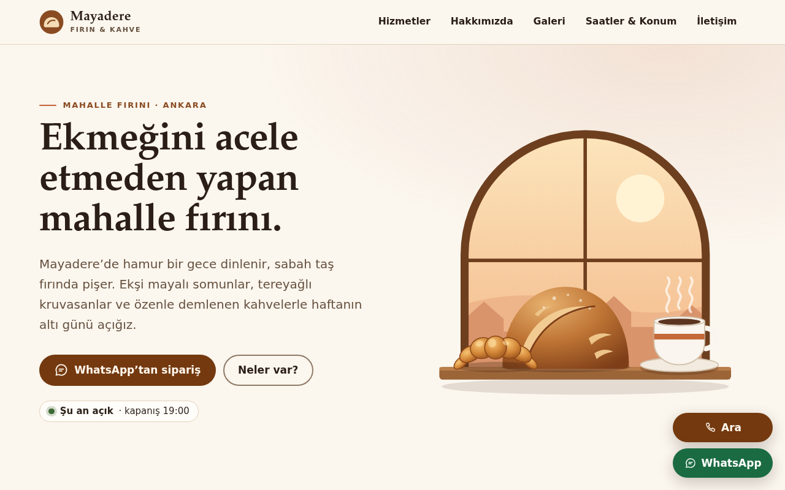
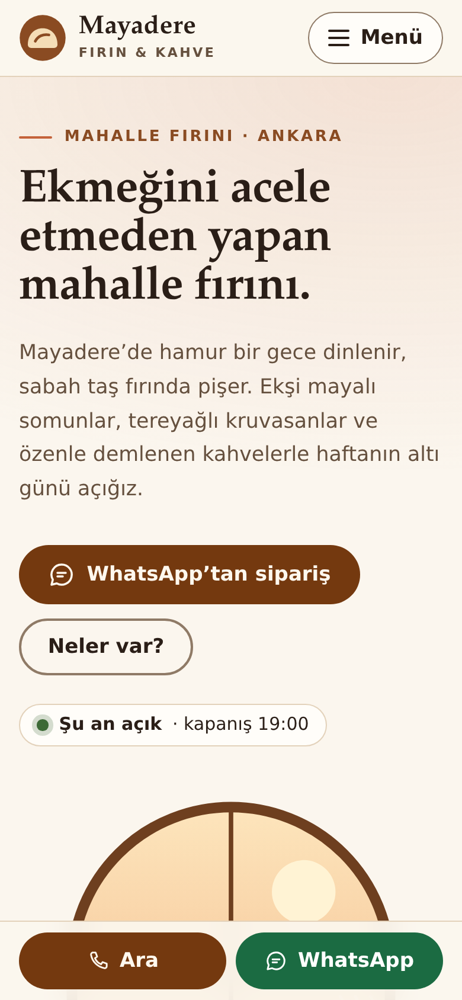
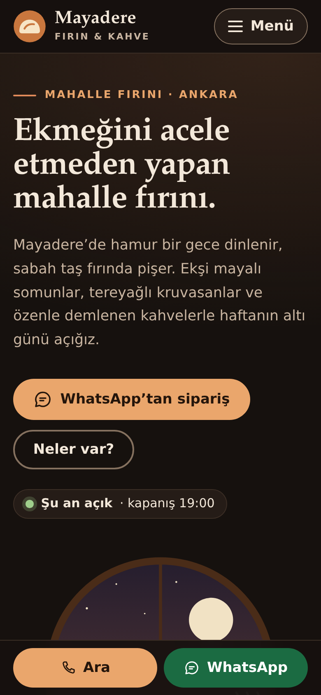

# Tek sayfalık tanıtım sitesi demosu

Küçük bir işletme için hazırlanmış tek sayfalık tanıtım sitesi örneği. Sitedeki **Mayadere Fırın & Kahve kurgusal bir işletmedir**; adres, telefon ve e-posta gerçek değildir.

**Canlı adres:** https://caniyli.github.io/tanitim-sitesi-demo/



<p>
  
  &nbsp;
  
</p>

Sayfanın tamamı (masaüstü): [docs/ekran-masaustu-tam.jpg](docs/ekran-masaustu-tam.jpg)

## Neler var

- **Tek sayfa:** kahraman alanı, hizmetler, hakkımızda, galeri, çalışma saatleri, konum, iletişim formu, alt bilgi.
- **Telefon ve tablet uyumu:** mobil öncelikli; 360, 768 ve 1280 piksel genişlikte kontrol edildi. Mobilde menü açılır panel olur.
- **Ara ve WhatsApp düğmeleri:** mobilde ekranın altında sabit, masaüstünde sağ altta.
- **Çalışma saatleri:** tablo halinde; Türkiye saatine göre "Şu an açık / kapalı" bilgisi ve bugünün satırı vurgulanır.
- **Konum:** üçüncü taraf harita yerine çizilmiş, hafif bir konum çizimi ve "Haritada aç" bağlantısı.
- **İletişim formu:** tarayıcıda doğrulama, Türkçe hata mesajları, hatalı ilk alana odak.
- **Açık ve koyu tema:** cihaz ayarına göre otomatik.
- **Erişilebilirlik:** anlamsal HTML ve başlık sırası, "İçeriğe geç" bağlantısı, klavyeyle gezinme, görünür odak çerçevesi, etiketli form alanları, ekran okuyucular için duyurular, `prefers-reduced-motion` desteği.
- **Arama motorları için temel ayarlar:** başlık ve açıklama, Open Graph (WhatsApp ve sosyal medya bağlantı önizlemesi), `Bakery` türünde (`LocalBusiness` alt türü) yapılandırılmış veri, SVG favicon.
- **Bağımlılık yok:** saf HTML, CSS ve tek bir JavaScript dosyası (`js/main.js`). Derleme adımı, çatı (framework), CDN, harici font, ikon paketi ya da analitik yok. Sayfa yalnızca kendi dosyalarını yükler; internet olmadan da açılır.

## Demoya özel davranışlar

Bu bir örnek olduğu için:

- **Ara, WhatsApp, e-posta ve "Haritada aç"** bağlantıları gerçek bir yere gitmez. Tıklanınca ne yapacaklarını anlatan küçük bir bilgi baloncuğu açılır. Bu davranış `data-demo` özniteliğiyle çalışır.
- **İletişim formu hiçbir yere veri göndermez.** Geçerli bir gönderimde "Demo: mesajınız gönderilmedi" bildirimi çıkar.
- **Galeride fotoğraf yerine** bu site için çizilmiş SVG görseller var. Stok fotoğraf ya da üçüncü taraf görsel kullanılmadı.

## Kendi işletmenize uyarlamak için

| Ne değişir | Nerede |
| --- | --- |
| Metinler (başlık, hizmetler, hakkımızda) | `index.html` |
| Renkler ve yazı tipleri | `css/style.css` başındaki değişkenler (`:root`; koyu tema için hemen altındaki blok) |
| Logo | `index.html` içindeki `#logo` sembolü, `assets/favicon.svg`, `assets/apple-touch-icon.png` |
| Telefon, WhatsApp, e-posta, adres | `index.html`: `tel:`, `wa.me`, `mailto:` bağlantıları, görünen metinler, JSON-LD bloğu ve alt bilgi |
| Çalışma saatleri | Tablodaki `data-hours` değerleri ve görünen saatler, JSON-LD bloğu, alt bilgi |
| Galeri | `assets/galeri/` içindeki çizimleri fotoğraflarla değiştirin (4:3 oranı önerilir) ve `alt` metinlerini güncelleyin |
| Konum | Çizimi gerçek konuma göre sadeleştirin ya da bir harita gömün; "Haritada aç" bağlantısına işletmenin harita adresini yazın |
| Paylaşım görseli | `assets/og-image.png` (1200 × 630) |
| Alan adı | `canonical`, `og:url`, `og:image` ve JSON-LD içindeki adresler |

Gerçek bir siteye dönüştürürken ayrıca:

1. `data-demo` özniteliklerini kaldırın; bağlantılar gerçek davranışına döner.
2. Formu bir form servisine ya da sunucuya bağlayın (`js/main.js` içinde `DEMO` yorumlu bölüm) ve `<form>` etiketine `action` ile `method` ekleyin.
3. Alt bilgideki demo notunu, galeri ve konum bölümlerindeki demo açıklamalarını kaldırın.
4. Kendi alan adınızda `robots.txt` ve `sitemap.xml` ekleyin. (GitHub Pages proje adresinde bu dosyalar alt dizinde kalacağı için arama motorları dikkate almaz; bu yüzden demoya eklenmedi.)

## Yerelde açmak

`index.html` dosyasını tarayıcıda açmak yeterli. İsterseniz basit bir sunucuyla:

```sh
python3 -m http.server 8000
# http://localhost:8000
```

## Nasıl kontrol edildi

- Chrome 145 başsız modda (DevTools protokolü ile): 360, 768 ve 1280 piksel genişlikte açık ve koyu tema ekran görüntüleri, yatay taşma, konsol hataları, sayfanın kendi dosyaları dışında istek yapmadığı, mobil menü, demo baloncuğu, form doğrulaması, klavyeyle gezinme ve azaltılmış hareket ayarı.
- Firefox 136 başsız modda yalnızca ilk ekranın görüntüsü alındı.
- Safari ve gerçek telefonlarda denenmedi. Lighthouse ya da benzeri bir performans puanı ölçülmedi.

## Lisans

[MIT](LICENSE) © 2026 Mert Can Iyli
